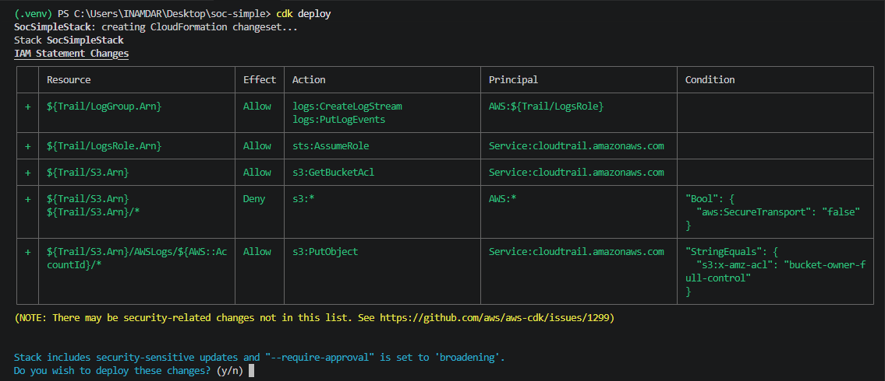
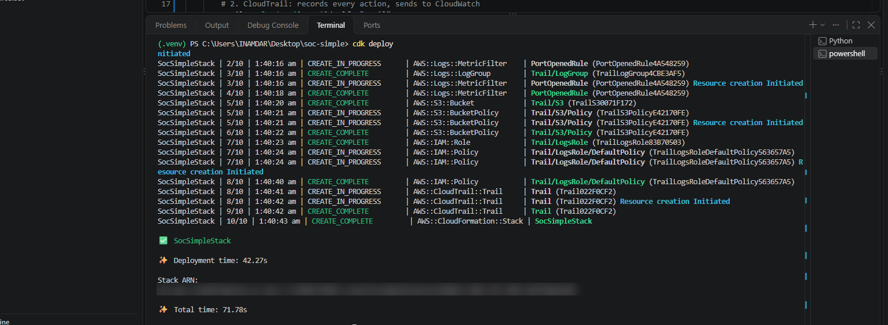
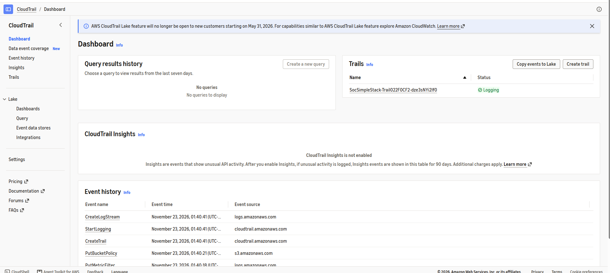
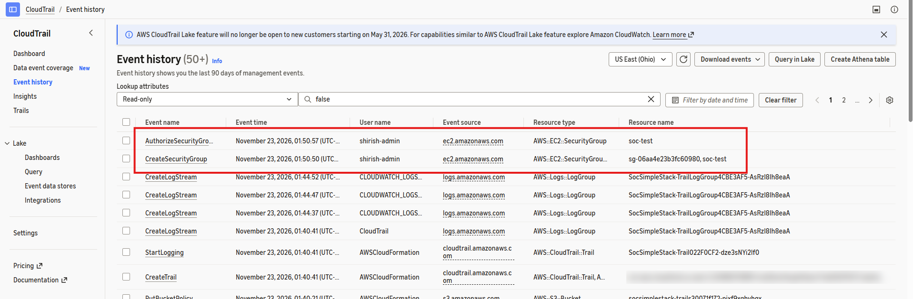
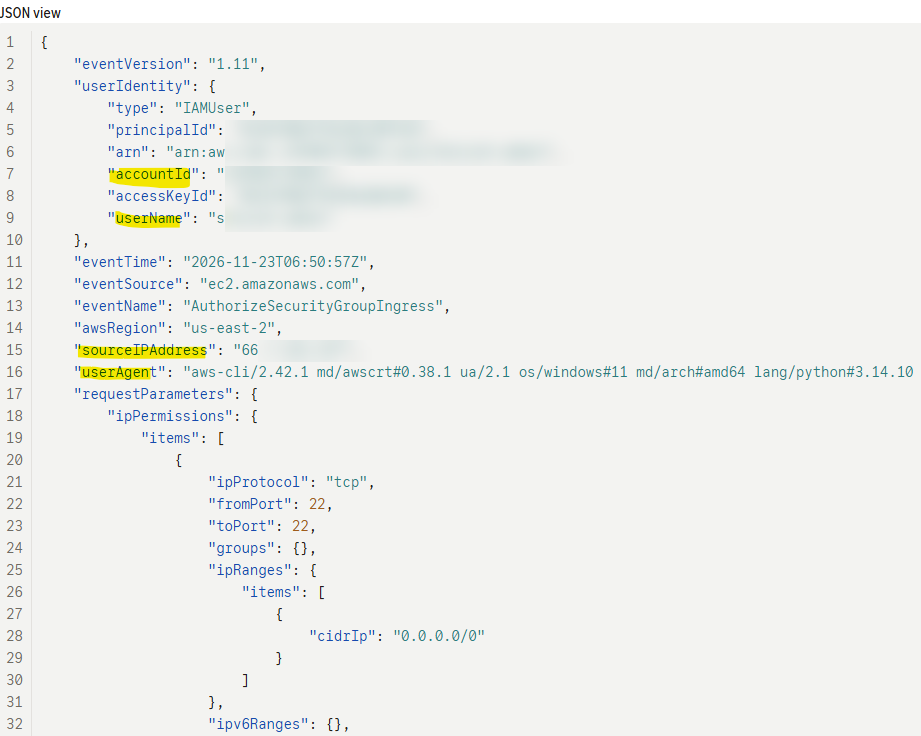
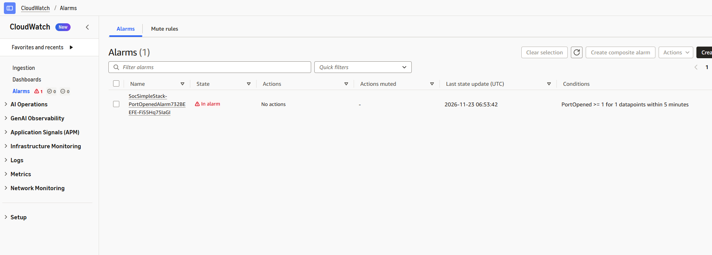
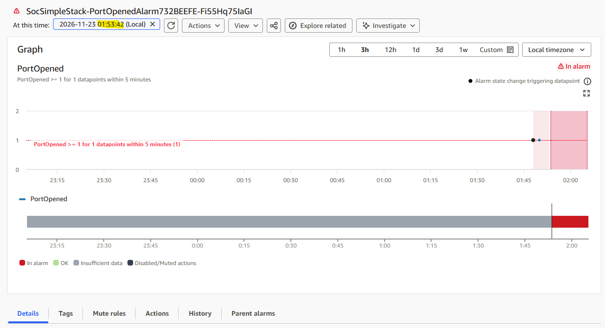

## Why I Built This

In a SOC, the most dangerous changes are often the quiet ones: someone opens a firewall port to the whole internet, and nobody notices until an attacker does. I wanted to build a small, realistic detection pipeline in AWS that catches exactly that, and I wanted to build it the way cloud security teams actually work: as **infrastructure as code**, not by clicking around the console.

The result is a mini SOC pipeline, written in about **30 lines of Python** with the **AWS Cloud Development Kit (CDK)**. It records every action in the account, detects when a security group is opened, and raises an alarm. I then tested it with a simulated attack and investigated the evidence the way an analyst would.

**The workflow:**

| Stage | What happens | AWS service |
|---|---|---|
| Log | Every API call is recorded: who, what, when, from where | CloudTrail |
| Detect | A rule watches the logs for `AuthorizeSecurityGroupIngress` | CloudWatch Logs metric filter |
| Alert | An alarm turns red when the rule matches | CloudWatch alarm |
| Investigate | The full event record is reviewed | CloudTrail Event history |
| Respond | The risky rule is removed | AWS CLI |

---

## Tools and Setup

Everything ran from a Windows 11 laptop, inside the VS Code terminal (PowerShell).

| Tool | Purpose |
|---|---|
| Python 3.14 | Runs the CDK code (`py` launcher on Windows) |
| Node.js (LTS) | Required by the CDK command-line tool |
| AWS CLI v2 | Connects the PC to the AWS account |
| AWS CDK v2 | Turns Python code into a CloudFormation template and deploys it |
| AWS account | A personal AWS project account, region `us-east-2` (Ohio) |

**The one-time setup steps:**

1. Install Python, Node.js and the AWS CLI with `winget`, then run `npm install -g aws-cdk`.
2. Allow local scripts in PowerShell:

    ```powershell
    Set-ExecutionPolicy -Scope CurrentUser RemoteSigned
    ```

3. Create an IAM user with an access key for the CLI, connect it with `aws configure`, and check the identity with `aws sts get-caller-identity`.
4. Bootstrap the account for CDK, which creates a staging S3 bucket, an ECR repository and deployment roles:

    ```powershell
    cdk bootstrap aws://<account-id>/us-east-2
    ```

5. Create the project and its Python environment:

    ```powershell
    cdk init app --language python
    .venv\Scripts\activate
    pip install -r requirements.txt
    ```

---

## The Code

The whole pipeline lives in one file, `soc_simple/soc_simple_stack.py`. It uses only basic Python: imports, a class with `__init__`, variables and function calls.

```python
from aws_cdk import Stack
from aws_cdk import aws_cloudtrail as cloudtrail
from aws_cdk import aws_logs as logs
from aws_cdk import aws_cloudwatch as cloudwatch
from constructs import Construct


class SocSimpleStack(Stack):

    def __init__(self, scope: Construct, id: str, **kwargs):
        super().__init__(scope, id, **kwargs)

        # 1. CloudTrail: records every action, sends to CloudWatch
        trail = cloudtrail.Trail(self, "Trail",
            send_to_cloud_watch_logs=True)

        # 2. CloudWatch rule: someone opened a port
        rule = logs.MetricFilter(self, "PortOpenedRule",
            log_group=trail.log_group,
            metric_namespace="SOC",
            metric_name="PortOpened",
            filter_pattern=logs.FilterPattern.literal(
                '{ $.eventName = "AuthorizeSecurityGroupIngress" }'))

        # 3. CloudWatch alarm: turns red if it happens
        cloudwatch.Alarm(self, "PortOpenedAlarm",
            metric=rule.metric(),
            threshold=1,
            evaluation_periods=1)
```

**What each part does:**

- **CloudTrail trail:** records every management API call in the account, across all regions. It writes the logs to an S3 bucket and streams them into a CloudWatch Logs log group.
- **Metric filter:** reads every CloudTrail record and counts the ones whose `eventName` is `AuthorizeSecurityGroupIngress`, the API call that opens a port in a security group.
- **Alarm:** goes into the **In alarm** state as soon as that count reaches 1 within a 5-minute window.

Before deploying, `cdk synth` previews the generated CloudFormation template. That is how I confirmed all the resources were there: the trail, S3 bucket, log group, IAM role, metric filter and alarm.

---

## Deploying with One Command

```powershell
cdk deploy
```

Before it changes anything, CDK lists every IAM permission it is about to create and asks for approval. **Reviewing this table is a security step in itself:**

| Permission | Meaning |
|---|---|
| `logs:CreateLogStream`, `logs:PutLogEvents` | CloudTrail may write into the CloudWatch log group |
| `sts:AssumeRole` for `cloudtrail.amazonaws.com` | Only the CloudTrail service can use that role |
| `s3:GetBucketAcl`, `s3:PutObject` | CloudTrail may save log files to the bucket |
| Deny `s3:*` when `aws:SecureTransport` is false | Blocks any non-HTTPS access to the logs |



After approval, CloudFormation built all **10 resources in about 42 seconds**.



In the CloudTrail console, the new trail showed **Logging** straight away. Event history had already recorded the deployment itself: `CreateTrail`, `StartLogging`, `PutBucketPolicy` and `CreateLogStream`.



---

## Simulating the Attack

To test the pipeline, I played the attacker and exposed **SSH (port 22) to the entire internet**:

```powershell
aws ec2 create-security-group --group-name soc-test --description test
aws ec2 authorize-security-group-ingress --group-name soc-test --protocol tcp --port 22 --cidr 0.0.0.0/0
```

### Step 1: CloudTrail Logged It

Within minutes, both actions appeared in CloudTrail Event history: `CreateSecurityGroup` at 01:50:50, and `AuthorizeSecurityGroupIngress` at 01:50:57.



### Step 2: Investigating the Event Record

Opening the `AuthorizeSecurityGroupIngress` event shows its full JSON record. These are the fields an analyst works from:

| Field | What it answers |
|---|---|
| `userIdentity.userName` | **Who** made the change (the IAM user) |
| `userIdentity.accessKeyId` | **Which credential** was used. In a real incident, this key gets disabled |
| `eventTime` | **When** it happened (UTC) |
| `sourceIPAddress` | **From where** the request came |
| `userAgent` | **How**: the AWS CLI on Windows, not the console |
| `fromPort` / `toPort` | **What** was opened: port 22 (SSH) |
| `cidrIp` | **To whom**: `0.0.0.0/0`, the entire internet. This is the high-risk part |



Written up as an incident ticket, it reads:

> At 01:50:57 EST, IAM user `shirish-admin`, from a known source IP via the AWS CLI, opened SSH (port 22) to `0.0.0.0/0` on security group `soc-test` in `us-east-2`. **Risk: high**, because the instance would be exposed to internet-wide SSH brute-force. **Action:** revoke the rule, confirm the change with the user, and rotate the access key if the change was unauthorized.

### Step 3: The Alarm Fired

The CloudWatch alarm moved to **In alarm** at 01:53:42, about **3 minutes** after the port was opened. Most of that time is CloudTrail's delivery delay.



The alarm's graph tells the same story on a timeline. The metric sits at 0 for hours, the attack datapoint hits the threshold of 1, and the state bar switches from gray (insufficient data) to red.



### Step 4: Response

I closed the hole by deleting the test security group:

```powershell
aws ec2 delete-security-group --group-name soc-test
```

---

## What Went Wrong, and What I Learned

The troubleshooting taught me as much as the build did.

1. **A student sandbox blocks CDK bootstrap.** My first attempt used an AWS Academy sandbox. `cdk bootstrap` failed with `not authorized to perform: ecr:CreateRepository`. The sandbox's fixed `voclabs` role blocks ECR, and bootstrap always creates an ECR repository. *Lesson:* restricted training accounts often can't run CDK as-is. `BootstraplessSynthesizer` is one workaround, and a personal account is the clean fix.
2. **SCPs beat AdministratorAccess.** In a second account, bootstrap failed with `explicit deny in a service control policy`, even though my IAM user had AdministratorAccess. Later, GuardDuty failed the same way in my project account. The deny came from the AWS Organization that manages the account. *Lesson:* a Service Control Policy sets the maximum permissions for every identity in an account. An explicit deny in an SCP overrides any IAM allow, including Admin. Reading the policy ARN in the error message tells you which organization owns the guardrail.
3. **CloudFormation is all or nothing.** When GuardDuty was denied, CloudFormation cancelled and rolled back every other resource too, even the ones that would have worked. The stack ended in `ROLLBACK_COMPLETE` and had to be deleted with `cdk destroy` before redeploying. *Lesson:* one blocked resource can sink a whole stack, so isolate optional services.
4. **Make sure you are editing the file CDK actually reads.** After I commented out GuardDuty, deploys kept failing. I had edited a stray copy of the stack file in the project root, while CDK imports `soc_simple/soc_simple_stack.py`. Running `cdk synth | Select-String GuardDuty` proved what the template really contained. *Lesson:* verify the synthesized template, not just the code on screen.
5. **Keep secrets out of screenshots and chats.** I accidentally pasted an access key while asking for help, so I deleted it and created a new one right away. *Lesson:* treat a leaked key as compromised. Rotate it immediately, and share only `aws sts get-caller-identity` output, never the keys.

---

## Results

| Metric | Result |
|---|---|
| Lines of Python | About 30 |
| Deployment time | About 42 seconds (10 resources) |
| Time from attack to alarm | About 3 minutes |
| Evidence captured | User, access key, time, source IP, tool, port, CIDR |
| Cost | Essentially $0. The first trail is free, and logs and the alarm cost cents |

## What's Next

- **Notify:** attach an SNS email action to the alarm, so an analyst is alerted instead of just seeing a red alarm.
- **Auto-respond (SOAR):** add an EventBridge rule on `AuthorizeSecurityGroupIngress` that triggers a Lambda function, which revokes any rule open to `0.0.0.0/0` within seconds.
- **Reset the alarm:** set `treat_missing_data` to `NOT_BREACHING`, so the alarm returns to OK once the incident has passed.
- **Threat detection:** add GuardDuty, and Detective for investigation timelines, in an account type that allows them.

## Cost and Cleanup

To avoid surprise charges, I set a budget alert, and I tear everything down when I'm done:

```powershell
cdk destroy
```

The CloudTrail S3 bucket and the CloudWatch log group have a **Retain** policy, so I delete those by hand in the console afterward.

## Takeaway

This small project covers the core SOC loop end to end: **log, detect, alert, investigate, respond.** It is built as code, so it can be reviewed, repeated and destroyed in minutes. The failures along the way, from sandbox restrictions to SCP denies and stack rollbacks, are the same problems cloud security teams debug every day.
